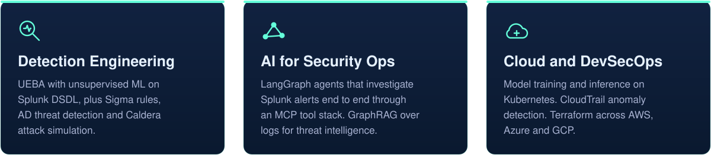

  
  
  
  

## About

I work where cybersecurity meets AI: ML-driven behavioural analytics, autonomous investigation agents, and detection engineering pipelines that help security teams find threats faster and more accurately.

- 🔭 **Focus:** UEBA, detection engineering, LangGraph agents, MCP tooling
- 📍 **Based in:** Bengaluru, India
- 🎓 **Education:** B.Tech Computer Science (Cybersecurity), SRM Institute of Science and Technology, 2024, CGPA 9.28
- 🥷 **Community:** Founder of the Hack The Box Meetup, Chennai
- 💬 **Ask me about:** insider-threat analytics, Active Directory detection, AI agents for the SOC, cloud security

 

## Toolbox

<table>
  <tr>
    <td width="170"><b>Core Competencies</b></td>
    <td>
    
    
    
    
    
    
    
    
    
    
    </td>
  </tr>
  <tr>
    <td width="170"><b>Agent Engineering</b></td>
    <td>
    
    
    
    
    
    
    
    
    
    
    
    </td>
  </tr>
  <tr>
    <td width="170"><b>Security Tools</b></td>
    <td>
    
    
    
    
    
    
    
    
    
    
    
    </td>
  </tr>
  <tr>
    <td width="170"><b>Cloud &amp; Infra</b></td>
    <td>
    
    
    
    
    
    
    
    
    
    
    
    
    
    
    
    </td>
  </tr>
  <tr>
    <td width="170"><b>Languages</b></td>
    <td>
    
    
    
    
    
    
    
    </td>
  </tr>
  <tr>
    <td width="170"><b>Dev Tooling</b></td>
    <td>
    
    
    
    
    
    
    </td>
  </tr>
  <tr>
    <td width="170"><b>IoT / Embedded</b></td>
    <td>
    
    
    
    
    
    
    
    
    </td>
  </tr>
</table>

## GitHub activity

  
  

 

  <picture>
    <source media="(prefers-color-scheme: dark)" srcset="dist/github-snake-dark.svg" />
    <source media="(prefers-color-scheme: light)" srcset="dist/github-snake.svg" />
    
  </picture>

 

## Certifications

  
  
  
  
  
  

## Community

### Hack The Box Meetup, Chennai

**Founder and organiser.** Monthly CTFs and workshops across red team challenges and blue team defence drills.

 

 

  <i>"I engineer AI systems that think like attackers."</i>
    
  

